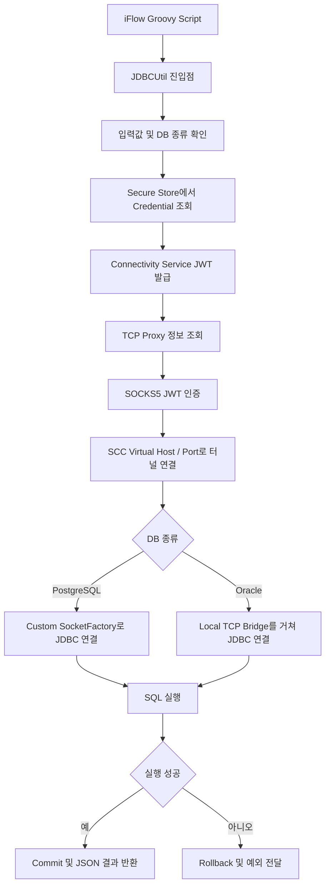

# JDBCUtil

SAP Integration Suite의 iFlow에서 SAP Connectivity Service와 SAP Cloud Connector(SCC)를 경유해 온프레미스 데이터베이스에 접속하고 SQL을 실행하기 위한 Java 라이브러리입니다.

현재 PostgreSQL과 Oracle을 지원합니다. Groovy Script가 DB 종류, SCC Virtual Host/Port, Location ID, Security Material 별칭과 SQL을 전달하면 JDBCUtil이 인증정보 조회, JWT 발급, SOCKS5 터널 생성, JDBC 연결 및 SQL 실행을 처리합니다.

> 이 저장소에는 데이터베이스 사용자명과 비밀번호를 기록하지 않습니다. 실제 인증정보는 SAP Integration Suite Security Material과 로컬 Docker의 `.env`에서 관리합니다.

## 주요 기능

- SAP Secure Store에서 Connectivity Service 및 DB Credential 조회
- OAuth 2.0 Client Credentials 방식으로 Connectivity Service JWT 발급
- `CloudConnectorProperties`를 통한 TCP Proxy 정보 조회
- JWT 인증 방식(`0x80`)을 사용하는 SOCKS5 터널 생성
- SCC Virtual Host/Port 및 Location ID 기반 TCP 연결 검사
- PostgreSQL과 Oracle JDBC 연결 검사
- 단일 SQL 또는 여러 SQL 순차 실행
- 여러 SQL을 하나의 트랜잭션으로 실행하고 실패 시 전체 롤백
- SELECT 결과와 DML 반영 건수를 JSON 문자열로 반환
- PostgreSQL 및 Oracle JDBC 드라이버를 포함한 Fat JAR 생성

## 지원 데이터베이스

| `databaseType` | JDBC 드라이버 | 연결 확인 쿼리 | SCC 터널 연결 방식 |
| --- | --- | --- | --- |
| `POSTGRESQL` | PostgreSQL JDBC `42.7.13` | `SELECT 1` | JDBC 드라이버에 `ConnectivitySocketFactory` 주입 |
| `ORACLE` | Oracle `ojdbc8 19.27.0.0` | `SELECT 1 FROM DUAL` | 로컬 TCP Bridge를 생성한 뒤 Oracle 드라이버 연결 |

`databaseName`은 PostgreSQL에서는 데이터베이스 이름, Oracle에서는 Service Name을 의미합니다.

## 처리 흐름



## 공개 API

Groovy Script에서는 `jdbcutil.JDBCUtil`의 정적 메서드를 호출합니다.

### TCP 연결 검사

```java
JDBCUtil.connectionTest(
    connectivityCredentialName,
    targetHost,
    targetPort,
    locationId
);
```

SCC 터널을 생성해 대상 Virtual Host/Port에 TCP 연결이 가능한지 확인합니다. 성공 시 `Connection Success`를 반환합니다.

### DB 연결 검사

```java
JDBCUtil.databaseConnectionTest(
    databaseType,
    connectivityCredentialName,
    databaseCredentialName,
    targetHost,
    targetPort,
    databaseName,
    locationId
);
```

PostgreSQL은 `SELECT 1`, Oracle은 `SELECT 1 FROM DUAL`을 실행해 JDBC 연결까지 확인합니다.

### SQL 실행

```java
JDBCUtil.execute(
    databaseType,
    connectivityCredentialName,
    databaseCredentialName,
    targetHost,
    targetPort,
    databaseName,
    locationId,
    query
);
```

마지막 인자로 단일 `String` 또는 `List<String>`을 전달할 수 있습니다. 여러 SQL은 같은 JDBC Connection에서 입력 순서대로 실행합니다. 모든 문장이 성공하면 Commit하고, 하나라도 실패하면 전체 Rollback 후 실패한 문장 번호를 포함한 예외를 전달합니다.

## 응답 형식

SELECT는 최대 1,000개의 행을 반환합니다.

```json
{
  "success": true,
  "resultType": "RESULT_SET",
  "columns": ["COLUMN_A", "COLUMN_B"],
  "rows": [["value", 1]],
  "rowCount": 1,
  "truncated": false
}
```

INSERT, UPDATE, DELETE 등 Result Set이 없는 문장은 반영 건수를 반환합니다.

```json
{
  "success": true,
  "resultType": "UPDATE_COUNT",
  "updateCount": 1
}
```

여러 SQL을 전달하면 `STATEMENT_RESULTS`와 문장별 결과를 입력 순서대로 반환합니다.

## 기술 구성

| 구분 | 사용 기술 |
| --- | --- |
| 언어 | Java, Java 8 호환 바이트코드(`--release 8`) |
| 빌드 환경 | Gradle Wrapper `9.2.0`, Java Toolchain 25 |
| 패키징 | Shadow Plugin `9.6.1`, Fat JAR |
| SAP API | Adapter API `3.21.0`, `ITApiFactory`, `SecureStoreService`, `CloudConnectorProperties` |
| 인증 | OAuth 2.0 Client Credentials, Basic 인증, JWT |
| HTTP | Java `HttpURLConnection` |
| 네트워크 | Java Socket, SOCKS5, Custom `SocketFactory`, TCP Bridge |
| JSON | Groovy JSON `4.0.29` |
| PostgreSQL | PostgreSQL JDBC `42.7.13` |
| Oracle | Oracle JDBC `ojdbc8 19.27.0.0` |

SAP Adapter API와 Groovy 클래스는 컴파일 시에만 참조하며 Fat JAR에는 포함하지 않습니다. 실제 클래스는 SAP Integration Suite 런타임에서 제공합니다. PostgreSQL과 Oracle JDBC 드라이버는 `jdbcutil.jar`에 포함되며 PostgreSQL 패키지는 `jdbcutil.internal.postgresql`로 relocation됩니다.

## 프로젝트 구조

```text
JDBCUtil/
  app/
    build.gradle
    src/main/java/jdbcutil/
      JDBCUtil.java
      connectivity/
        ConnectivityProxyClient.java
        ConnectivityTokenClient.java
        Socks5Client.java
        socket/
          ConnectivitySocketFactory.java
          ConnectivityTcpBridge.java
      database/
        DatabaseType.java
        oracle/OracleClient.java
        postgresql/PostgresClient.java
      model/
      security/
        SecureStoreCredentialClient.java
  docker/
    compose.yaml
    .env.example
    oracle/init/
    postgres/init/
  gradle/
  gradle.properties
  settings.gradle
  gradlew
  gradlew.bat
```

| 클래스 | 역할 |
| --- | --- |
| `JDBCUtil` | Groovy에서 호출하는 공개 진입점 및 DB 종류별 Client 분기 |
| `DatabaseType` | `POSTGRESQL`, `ORACLE` 입력 검증 |
| `ConnectivityTokenClient` | Connectivity Credential 조회 및 JWT 발급 |
| `ConnectivityProxyClient` | SAP 런타임에서 TCP Proxy 호스트와 포트 조회 |
| `Socks5Client` | JWT 인증 및 SCC 대상에 대한 SOCKS5 CONNECT 처리 |
| `ConnectivitySocketFactory` | PostgreSQL JDBC 소켓을 SCC 터널로 연결 |
| `ConnectivityTcpBridge` | Oracle JDBC 연결과 SCC 터널 사이의 양방향 TCP 전달 |
| `PostgresClient` | PostgreSQL 연결 검사, 트랜잭션 및 SQL 실행 |
| `OracleClient` | Oracle 연결 검사, 트랜잭션 및 SQL 실행 |
| `SecureStoreCredentialClient` | SAP Secure Store에서 User Credential 조회 |

## 빌드

Gradle 실행에는 Java 17 이상이 필요합니다. 현재 프로젝트는 Java Toolchain 25로 컴파일하고 결과 클래스는 Java 8 호환 바이트코드로 생성합니다.

```powershell
java -version
./gradlew.bat clean build
```

Fat JAR 생성만 실행하려면 다음 명령을 사용합니다.

```powershell
./gradlew.bat :app:shadowJar
```

결과 파일은 `app/build/libs/jdbcutil.jar`입니다. 이 JAR만 iFlow의 Resources에 추가하며 별도의 PostgreSQL 또는 Oracle JDBC JAR를 중복 업로드하지 않습니다.

## SAP 연결 설정

### Connectivity Credential

SAP Integration Suite Security Material에 Connectivity Service 호출용 Credential을 등록하고 코드에는 해당 별칭만 전달합니다. 현재 구현은 다음 정보를 사용합니다.

- `getUsername()`: OAuth Client ID
- `getPassword()`: OAuth Client Secret
- `getCredentialProperties().get("sec:server.url")`: Token URL

Token URL은 HTTPS여야 합니다. JDBCUtil은 `grant_type=client_credentials`로 토큰을 요청하며 HTTP Redirect를 따라가지 않습니다.

### Database Credential

PostgreSQL과 Oracle 접속정보는 각각 SAP Security Material의 User Credential로 관리합니다. 요청에서는 실제 사용자명이나 비밀번호가 아니라 Security Material 별칭만 `databaseCredentialName`으로 전달합니다.

### SCC 매핑

`targetHost`와 `targetPort`에는 SCC의 Cloud To On-Premise에 등록된 Virtual Host와 Virtual Port를 전달합니다. `locationId`는 해당 SCC 설정과 일치해야 하며 기본 Location ID를 사용하는 경우 빈 문자열로 전달할 수 있습니다.

## iFlow 호출 예제

다음 예제는 요청 JSON을 파싱해 단일 SQL 또는 다중 SQL 메서드를 호출합니다. Credential 필드에는 인증정보가 아닌 Security Material 별칭을 전달합니다.

```groovy
import com.sap.gateway.ip.core.customdev.util.Message
import groovy.json.JsonSlurper
import jdbcutil.JDBCUtil

Message processData(Message message) {
    def request = new JsonSlurper().parseText(message.getBody(String))
    def query = request.query

    String result
    if (query instanceof List) {
        result = JDBCUtil.execute(
            request.databaseType as String,
            request.connectivityCredentialName as String,
            request.databaseCredentialName as String,
            request.targetHost as String,
            request.targetPort as int,
            request.databaseName as String,
            (request.locationId ?: '') as String,
            query.collect { it as String }
        )
    } else {
        result = JDBCUtil.execute(
            request.databaseType as String,
            request.connectivityCredentialName as String,
            request.databaseCredentialName as String,
            request.targetHost as String,
            request.targetPort as int,
            request.databaseName as String,
            (request.locationId ?: '') as String,
            query as String
        )
    }

    message.setHeader('Content-Type', 'application/json; charset=UTF-8')
    message.setBody(result)
    return message
}
```

### PostgreSQL 요청

```json
{
  "databaseType": "POSTGRESQL",
  "connectivityCredentialName": "<Connectivity Security Material 별칭>",
  "databaseCredentialName": "<PostgreSQL Security Material 별칭>",
  "targetHost": "<SCC Virtual Host>",
  "targetPort": 5432,
  "databaseName": "<Database Name>",
  "locationId": "<Location ID>",
  "query": "SELECT CURRENT_TIMESTAMP"
}
```

### Oracle 요청

```json
{
  "databaseType": "ORACLE",
  "connectivityCredentialName": "<Connectivity Security Material 별칭>",
  "databaseCredentialName": "<Oracle Security Material 별칭>",
  "targetHost": "<SCC Virtual Host>",
  "targetPort": 1521,
  "databaseName": "<Oracle Service Name>",
  "locationId": "<Location ID>",
  "query": "SELECT SYSDATE FROM DUAL"
}
```

### 다중 SQL 요청

```json
{
  "databaseType": "POSTGRESQL",
  "connectivityCredentialName": "<Connectivity Security Material 별칭>",
  "databaseCredentialName": "<Database Security Material 별칭>",
  "targetHost": "<SCC Virtual Host>",
  "targetPort": 5432,
  "databaseName": "<Database Name>",
  "locationId": "<Location ID>",
  "query": [
    "DELETE FROM first_table WHERE record_key <= 1000",
    "INSERT INTO second_table (record_key, record_value) SELECT value, value FROM generate_series(1, 1000) AS value"
  ]
}
```

## 로컬 DB 테스트 환경

`docker/compose.yaml`은 PostgreSQL 16과 Oracle XE 21 테스트 컨테이너를 함께 실행합니다. DB 사용자명과 비밀번호는 Git에 포함되지 않는 `docker/.env`에 설정합니다.

```powershell
cd docker
Copy-Item .env.example .env

docker volume create jdbcutil-oracle_oracle-data
docker compose --env-file .env up -d
docker compose ps
```

`.env`의 인증정보를 변경해도 이미 생성된 DB 볼륨의 계정과 비밀번호는 자동으로 변경되지 않습니다. 초기 계정 설정을 다시 적용하려면 테스트 데이터 삭제 가능 여부를 확인한 후 볼륨을 새로 생성해야 합니다.

## 보안 및 제한사항

- SQL 문자열을 검사하거나 허용 목록과 비교하지 않고 그대로 `PreparedStatement`에 전달합니다.
- 값 바인딩을 사용하지 않으므로 호출자가 SQL에 외부 입력을 직접 조합하면 SQL Injection 위험이 있습니다.
- 외부에 공개된 Endpoint에서 사용하지 말고 DB Credential에 필요한 최소 권한만 부여해야 합니다.
- SELECT 결과는 최대 1,000행으로 제한됩니다.
- JDBC Query Timeout은 60초입니다.
- Connectivity Proxy 및 대상 연결 Timeout은 기본 10초입니다.
- DB별 SQL 문법 차이는 호출자가 처리해야 합니다.
- SAP Script 런타임 버전과 외부 라이브러리 ClassLoader 정책에 따라 호환성 검증이 필요합니다.

## 향후 개선사항

- SQL 템플릿과 파라미터 바인딩을 분리한 안전한 PreparedStatement API
- 실행 가능한 SQL 유형 및 대상 테이블 Allowlist
- DB 종류별 통합 테스트 자동화
- Script 2.x ClassLoader 호환성 검증 및 보완
- 쿼리별 Timeout, 최대 반환 행 수 등 실행 옵션 외부화