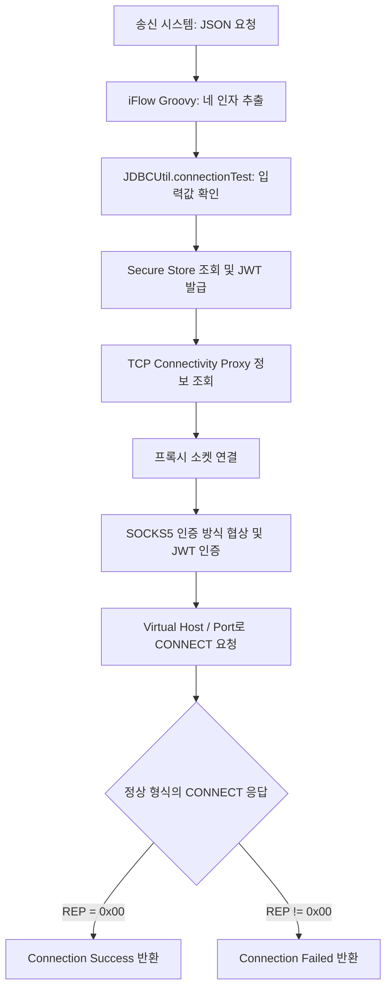

# JDBCUtil

SAP Integration Suite의 iFlow에서 Connectivity Proxy와 SAP Cloud Connector(SCC)를 경유해 온프레미스 PostgreSQL에 JDBC로 연결하기 위한 Java 라이브러리입니다.

Groovy Script에서 Connectivity Credential, Database Credential, Virtual Host, Virtual Port, Database Name, Location ID를 전달하면 JWT 발급, SOCKS5 터널 생성, PostgreSQL 연결 확인과 SQL 실행까지 수행합니다. DB 연결과 별도로 온프레미스 TCP 연결만 점검하는 기능도 제공합니다.

> TCP 연결 검사의 성공은 대상 포트에 연결이 수립되었다는 의미입니다. SQL 실행 기능은 별도 메서드로 제공됩니다.

## 주요 기능

- **인증정보 조회 및 JWT 발급**: SAP Secure Store에서 Credential을 조회하고, HTTPS POST와 Basic 인증으로 `client_credentials` 토큰을 요청합니다.
- **프록시 정보 조회**: `CloudConnectorProperties`에서 TCP Connectivity Proxy의 호스트와 포트를 가져옵니다.
- **SOCKS5 연결 검사**: 인증 방식 `0x80` 협상, JWT·Location ID 인증, Virtual Host·Port에 대한 CONNECT 요청을 수행합니다.
- **PostgreSQL 연결 검사**: SCC 터널을 PostgreSQL JDBC 드라이버의 소켓으로 사용하고 `SELECT 1`로 DB 연결을 확인합니다.
- **PostgreSQL SQL 실행**: JSON의 `query` 값을 `PreparedStatement`로 실행하고 Result Set 또는 반영 건수를 JSON으로 반환합니다.
- **단일 JAR 생성**: PostgreSQL 드라이버를 내부 패키지로 relocation한 `jdbcutil.jar`를 생성해 SAP 런타임의 클래스 충돌을 줄입니다.
- **응답 검증**: 프로토콜 버전, 인증 결과, CONNECT 응답을 확인하고 IPv4·도메인·IPv6 형식의 응답 주소를 끝까지 읽습니다.
- **자원 관리**: HTTP 연결과 TCP 소켓을 종료하고 연결·읽기 타임아웃을 적용합니다.

대상 호스트는 SOCKS5 요청에 문자열로 전달하며 로컬 DNS로 해석하지 않습니다. 요청마다 새 JWT를 발급하고 새 소켓으로 대상 하나를 검사합니다.

## 처리 흐름

아래 Groovy 호출 예제를 사용하는 iFlow 구성 기준입니다.



입력 오류, SAP API 오류, 인증 실패, 타임아웃, 잘못되거나 중단된 응답은 예외로 호출자에게 전달합니다. 소켓은 결과 반환과 예외 발생 모두에서 자동으로 닫힙니다.

## 기술 구성

| 구분 | 사용 기술 |
| --- | --- |
| 언어 | Java, 빌드 JDK 21 / 자체 Java 코드 컴파일 대상 Java 8 |
| 빌드 | Gradle Wrapper 9.2.0, `java-library` |
| SAP API | `com.sap.cloud.adk:adapter.api:3.21.0`, `ITApiFactory`, `SecureStoreService`, `CloudConnectorProperties` |
| 토큰 요청 | Java `HttpURLConnection`, HTTPS, OAuth 2.0 Client Credentials |
| JSON 처리 | `groovy-json:4.0.29`의 `JsonSlurper` |
| TCP 통신 | `Socket`, `DataInputStream`, `DataOutputStream`, SOCKS5 |
| 인증 데이터 처리 | Java `Base64`, UTF-8 |

## 프로젝트 구조

```text
jdbcutil/
  app/
    build.gradle
    src/main/java/jdbcutil/
      JDBCUtil.java
      connectivity/
        ConnectivityTokenClient.java
        ConnectivityProxyClient.java
        Socks5Client.java
      database/postgresql/
        PostgresClient.java
        PostgresConnectivitySocketFactory.java
      model/
        ConnectivityProxyInfo.java
        OnPremiseTargetInfo.java
      security/
        SecureStoreCredentialClient.java
  examples/
    tcp-request.json
  gradle/
    wrapper/
  gradle.properties
  settings.gradle
  gradlew
  gradlew.bat
```

| 클래스 | 역할 |
| --- | --- |
| [JDBCUtil](app/src/main/java/jdbcutil/JDBCUtil.java) | Groovy에서 호출하는 진입점. TCP 검사, PostgreSQL 연결 검사 및 SQL 실행을 제공 |
| [ConnectivityTokenClient](app/src/main/java/jdbcutil/connectivity/ConnectivityTokenClient.java) | Credential 조회, 토큰 URL 검증, JWT 요청 및 `access_token` 추출 |
| [ConnectivityProxyClient](app/src/main/java/jdbcutil/connectivity/ConnectivityProxyClient.java) | `ConnectionType.TCP`로 프록시 호스트·포트 조회 |
| [Socks5Client](app/src/main/java/jdbcutil/connectivity/Socks5Client.java) | 소켓 관리, SOCKS5 인증과 CONNECT 요청, 결과 판정 |
| [PostgresClient](app/src/main/java/jdbcutil/database/postgresql/PostgresClient.java) | Database Credential과 PostgreSQL JDBC 드라이버를 사용해 연결, 트랜잭션 및 SQL 실행 수행 |
| [PostgresConnectivitySocketFactory](app/src/main/java/jdbcutil/database/postgresql/PostgresConnectivitySocketFactory.java) | PostgreSQL 소켓을 Connectivity Proxy에 연결하고 SCC 터널 생성 |
| [SecureStoreCredentialClient](app/src/main/java/jdbcutil/security/SecureStoreCredentialClient.java) | SAP Secure Store에서 Credential 조회 |
| [ConnectivityProxyInfo](app/src/main/java/jdbcutil/model/ConnectivityProxyInfo.java) | Connectivity Proxy의 호스트·포트 보관 |
| [OnPremiseTargetInfo](app/src/main/java/jdbcutil/model/OnPremiseTargetInfo.java) | 대상 호스트·포트와 연결 유형 보관. 현재 진입점에서는 TCP로 생성 |

## 빌드

프로젝트 루트에서 **JDK 21**을 사용합니다.

```bat
java -version
javac -version
gradlew.bat clean build
```

빌드 결과는 `app/build/libs/jdbcutil.jar`에 생성됩니다.

## 연결정보 설정

실제 Client ID, Client Secret은 Integration Suite의 Security Material에서 관리합니다. 코드가 사용하는 값은 다음과 같습니다.

| 조회 위치 | 사용 목적 |
| --- | --- |
| `getUserCredential(credentialName)` | 별칭에 해당하는 Credential 조회 |
| `credential.getUsername()` | 토큰 요청의 Client ID |
| `credential.getPassword()` | 토큰 요청의 Client Secret |
| `credential.getCredentialProperties().get("sec:server.url")` | 전체 토큰 발급 URL |

이 매핑은 현재 구현의 전제입니다. **선택한 Credential에서 `sec:server.url` 속성이 제공되어야 합니다.** 일반 User Credentials에 ID·Password만 등록했다고 토큰 URL까지 제공되는 것은 아니므로, 사용할 Security Material 구성을 확인해야 합니다. [SAP Secure Store 문서](https://help.sap.com/docs/integration-suite/sap-integration-suite/read-security-related-artifacts)

토큰 URL은 HTTPS여야 하며 설정된 URL을 그대로 사용합니다. `/oauth/token`을 자동으로 덧붙이거나 쿼리를 제거하지 않습니다. Authorization 헤더에는 `Basic Base64(clientId:clientSecret)`, 요청 본문에는 `grant_type=client_credentials`를 사용하며 리다이렉트는 따라가지 않습니다.

`targetHost`와 `targetPort`는 SCC에 등록된 **Virtual Host / Virtual Port**를 입력합니다. `locationId`는 해당 SCC의 설정과 일치해야 하며, 기본 Location ID는 빈 문자열 `""`로 전달합니다. JAR에서는 `null`도 빈 문자열로 처리합니다.

## iFlow에서 호출

iFlow는 `HTTPS Sender -> Groovy Script -> End`로 구성하고 JAR를 리소스에 추가합니다. SAP API와 Groovy JSON 클래스가 해당 런타임에서 사용 가능해야 합니다.

아래는 **iFlow에 작성할 Groovy Script 2.0 예제**입니다. 별도 스크립트 파일이 저장소에 포함되어 있는 것은 아닙니다. Script 2.0의 Groovy 런타임은 SAP 문서를 참고합니다. [SAP Script Step 문서](https://help.sap.com/docs/integration-suite/sap-integration-suite/define-local-script-step)

```groovy
import com.sap.it.script.v2.api.Message
import groovy.json.JsonSlurper
import jdbcutil.JDBCUtil

Message processData(Message message) {
    def request = new JsonSlurper().parseText(
        message.getBody(String)
    )

    String result = JDBCUtil.connectionTest(
        request.credentialName as String,
        request.targetHost as String,
        request.targetPort as int,
        (request.locationId ?: '') as String
    )

    message.setHeader('Content-Type', 'text/plain; charset=UTF-8')
    message.setBody(result)

    return message
}
```

호출 인자 순서는 `credentialName, targetHost, targetPort, locationId`입니다. JSON 파싱은 Groovy에서 수행하며 Java 진입점은 네 값을 직접 받습니다. HTTPS Sender에 접근하기 위한 인증은 iFlow에서 별도로 설정합니다.

송신 예시:

```http
POST https://<integration-runtime-url>
Content-Type: application/json

{
  "targetHost": "virtual-backend.example",
  "targetPort": 50000,
  "locationId": "",
  "credentialName": "ConnectivityProxy",
}
```

위 URL의 경로는 HTTPS Sender에 설정할 예시입니다. [JSON 요청 예제](examples/tcp-request.json)도 참고할 수 있습니다.

## PostgreSQL SQL 실행 POC

다음 Groovy Script는 송신 측에서 완성한 SQL 문자열을 요청 JSON의 `query`로 받아 PostgreSQL에서 그대로 실행합니다. JDBCUtil은 SQL을 조립하거나 값을 추가로 바인딩하지 않습니다.

```groovy
import com.sap.it.script.v2.api.Message
import groovy.json.JsonSlurper
import jdbcutil.JDBCUtil

Message processData(Message message) {
    def request = new JsonSlurper().parseText(
        message.getBody(String)
    )

    String result = JDBCUtil.executePostgres(
        request.connectivityCredentialName as String,
        request.databaseCredentialName as String,
        request.targetHost as String,
        request.targetPort as int,
        request.databaseName as String,
        (request.locationId ?: '') as String,
        request.query as String
    )

    message.setHeader('Content-Type', 'application/json; charset=UTF-8')
    message.setBody(result)
    return message
}
```

요청 예제:

```json
{
  "connectivityCredentialName": "ConnectivityProxy",
  "databaseCredentialName": "PostgresCredential",
  "targetHost": "virtual-postgres.example",
  "targetPort": 5432,
  "databaseName": "postgre",
  "locationId": "",
  "query": "INSERT INTO connection_test (message) VALUES ('JDBCUtil POC')"
}
```

INSERT, UPDATE, DELETE 결과는 반영 건수를 반환합니다.

```json
{
  "success": true,
  "resultType": "UPDATE_COUNT",
  "updateCount": 1
}
```

SELECT를 전달하면 컬럼 목록과 최대 1,000개의 행을 반환합니다.

```json
{
  "success": true,
  "resultType": "RESULT_SET",
  "columns": ["id", "message", "created_at"],
  "rows": [[1, "JDBCUtil POC", "2026-09-18 10:00:00"]],
  "rowCount": 1,
  "truncated": false
}
```

[전체 요청 예제](examples/postgres-query-request.json)도 참고할 수 있습니다.

### 보안 제한

이 기능은 사내 POC를 위한 초기 구현입니다. `query`에 전달된 SQL을 별도로 정제하거나 허용 목록과 비교하지 않고 실행하므로, 외부에 공개된 Endpoint에서 사용하면 안 됩니다. 한 요청에 한 SQL문을 전달하는 것을 전제로 하며 DB 계정에는 필요한 최소 권한만 부여해야 합니다. SQL 실행 실패 시 트랜잭션을 rollback하고 예외를 iFlow에 전달합니다.

## 결과와 제약

| 결과 | 의미 |
| --- | --- |
| `Connection Success` | SOCKS5 CONNECT 응답을 끝까지 정상적으로 읽었고 결과 코드가 `0x00` |
| `Connection Failed` | 정상 형식의 CONNECT 응답을 받았지만 결과 코드가 `0x00`이 아님 |
| 예외 발생 | 입력 오류, Credential·프록시 조회 실패, 토큰 발급·인증 실패, 통신 오류 등 |

반환형은 `String`입니다. JAR 자체는 JSON 응답이나 HTTP 상태 코드를 생성하지 않으며, 예외 처리와 HTTP 응답 정책은 호출하는 iFlow에서 정합니다.

| 항목 | 현재 설정 |
| --- | --- |
| 토큰 HTTP 연결 / 읽기 타임아웃 | 각각 60초 |
| 프록시 소켓 연결 / 읽기 타임아웃 | 각각 10초 |
| 대상 포트 | 1~65535 |
| 대상 호스트 길이 | UTF-8 기준 최대 255바이트, 빈 값 불가 |
| Location ID 길이 | Base64 인코딩 후 최대 255바이트 |

타임아웃은 각 연결·읽기에 적용되며 전체 요청의 총 실행시간 제한은 아닙니다. 연결 검사에는 실제 SAP 런타임, 유효한 Credential, SCC 매핑과 네트워크 경로가 필요합니다. 검사 성공 후에는 업무 데이터를 전송하지 않고 소켓을 닫습니다.

## Future Improvements

- SOCKS5 분할 응답, 인증 거절, CONNECT 실패, 타임아웃에 대한 자동화 테스트와 테스트 설정 정리
- Cloud Connector Info API를 통한 등록 대상 조회와 여러 대상의 연결 검사
- HTTP 요청·응답 및 TLS 핸드셰이크 검사
- JWT 만료시간을 고려한 토큰 재사용
